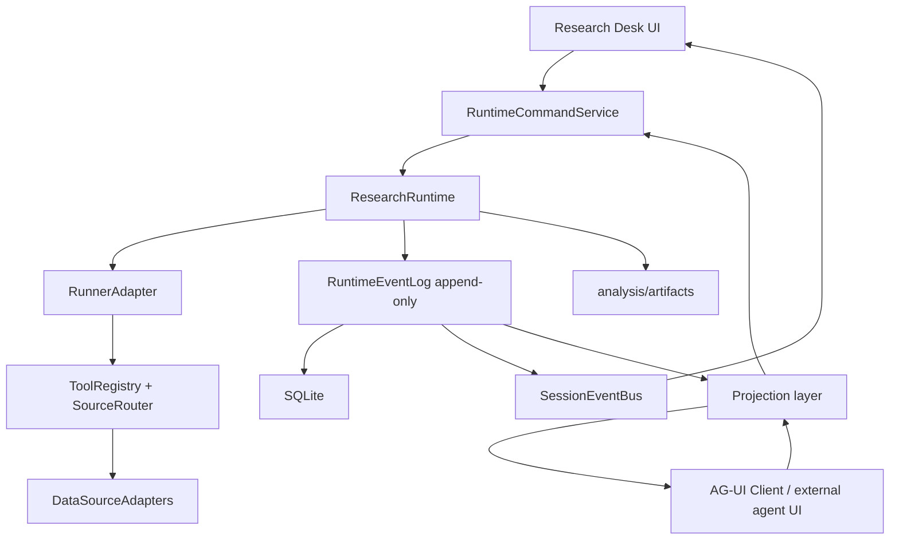

# Research Runtime Protocol Refactor 设计文档

日期：2026-06-02

修订：2026-06-03 — 根据用户反馈，将路线从“渐进协议收口”升级为“彻底重构：DB vNext、Runner 接口 vNext、协议层直接切换”，并明确不保留运行时技术债。

状态：Draft，供用户审核

关联文档：

- `docs/superpowers/specs/2026-05-30-research-runtime-design.md`
- `docs/superpowers/specs/2026-05-30-research-runtime-v2-design.md`
- `docs/superpowers/specs/data-source-v2.md`

## 0. 结论

当前 `stock-skills` 已经不是一个纯 prompt/skill 仓库。它已经具备 Research Desk 的主要骨架：

- Next.js App Router + React + Zustand 前端。
- SQLite/Drizzle 的 `sessions`、`messages`、`runs`、`artifacts`、`run_events`、`session_events`、`observations`、`decisions`、`lessons`、`data_providers`、`data_capabilities`、`data_source_routes`。
- `EventBus` + SSE 的实时通道。
- `TaskRunner` + `PiAgentRunner` 的后台 agent 执行。
- `SourceRouter` + native TypeScript `FutuAdapter` 的数据源路由和 OpenD 集成。

现在的主要问题不是缺模块，而是缺一套明确的协议层。前端、API route、EventBus、DB event、agent runner、tool adapter 都在用相似但不完全一致的事件和状态概念。继续修局部 UI/SSE bug 会越来越像补丁堆叠。

推荐改造方向：

> 建立 repo-owned `RuntimeEvent` 协议作为内部事实来源；将 AG-UI 作为 UI/外部客户端的标准事件投影；将 Mastra、LangGraph、OpenAI Agents SDK、Vercel AI SDK 等 agent framework 只作为可插拔 runner，而不是让任何一个外部框架接管本项目的产品状态、DB schema 或数据源模型。

用户进一步建议做彻底重构，并明确“不需要留下债务，可以都清除掉”。因此本设计不再以“旧表上补字段 + route handler 渐进瘦身”为主线，也不再保留旧 REST/SSE/runner 运行时适配层，而改为“新 runtime 内核 + 一次性迁移 + 直接切换”：

1. DB 使用 vNext canonical schema。旧 `messages/runs/run_events/session_events/artifacts` 只作为 migration source，不再作为运行时模型，也不提供长期 compatibility view。
2. Runner 接口使用 vNext `RunnerAdapter`。默认目标是现代 code-first agent：OpenAI Agents SDK / Responses API 负责模型、工具、handoff、streaming、tracing 等核心 agent 能力；Mastra 负责 TypeScript workflow、memory、evals、observability 和本地 developer studio。当前 `PiAgentRunner` 不进入 vNext runtime；最多作为 migration/test snapshot 的对照材料，重构完成后从热路径删除。
3. 协议层直接切到 canonical API。内部只认 `RuntimeCommand` / `RuntimeEvent`；外部标准协议只保留 AG-UI projection，不再保留 legacy REST/SSE adapter。
4. 前端只消费一个 canonical client event reducer；旧 `text_delta`、`tool_call`、`run.updated` 之类事件在 migration fixture 中允许出现，但不得进入 vNext UI 运行时输入。
5. OpenD/Futu 继续保持 native TS adapter，不允许 shell out 到旧 Python scripts。

这里将用户提到的“DB burner 接口”理解为“DB + runner 接口”的彻底改造：即 DB schema 和 agent runner boundary 都不再小修小补。如果“burner”指的是另一个具体子系统，后续实现计划中需要再改名对齐。

## 1. 当前现状

### 1.1 技术栈现状

`package.json` 显示当前项目已经是 TypeScript 全栈应用：

- Next.js `^15.3.3`
- React `^19.1.0`
- Drizzle ORM `^0.44.2`
- better-sqlite3 `^11.9.1`
- Zustand `^5.0.5`
- `@earendil-works/pi-agent-core` / `@earendil-works/pi-ai`
- `futu-api`
- Tailwind、Radix、lucide、Vitest、Biome

这意味着 v2 spec 里的“Next.js 单包全栈”路线已经基本落地。新的改造不应该回到 FastAPI/Python server，也不应该为了引入某个 agent framework 把整个产品拆成多服务，除非后面有非常明确的多进程隔离需求。

### 1.2 DB 现状

`src/lib/db/schema.ts` 里已经有核心业务表：

- `sessions`：会话。
- `messages`：用户/助手/system 消息，metadata 为 JSON string。
- `research_goals`、`goal_criteria`、`goal_evidence`：研究目标和证据。
- `runs`：一次执行，`metadata` 存 ticker/workflow/caller 等扩展字段。
- `artifacts`：报告、图表、数据、模型产物。
- `run_events`：run 级事件，`eventType` + JSON `data`。
- `session_events`：session 级事件。
- `observations`、`decisions`、`lessons`：结构化研究记忆。
- `data_providers`、`data_capabilities`、`data_source_routes`：数据源 v2。

这个模型方向正确，但现在事件层不够规范：

- `run_events` 和 `session_events` 是两套表，事件 envelope 不一致。
- `run_events.data` 是自由 JSON，没有 `schema_version`、`producer`、`event_id` 语义、`visibility`、`correlation_id`、`idempotency_key`。
- `runs` 的关键字段大量藏在 `metadata`，导致查询、筛选、状态机验证都不够直接。
- `artifacts` 接口返回了 checksum，但表里没有存 `sha256`、`size_bytes`、`schema_version`、`producer`、`source_event_id`。
- tool call 现在以 `run_events.eventType = "tool_use"` 记录，而且从 running 更新为 completed/error。这方便查最新状态，但不符合 append-only event log。

### 1.3 后端交互现状

当前主路径在 `src/app/api/sessions/[id]/messages/route.ts`：

1. 校验 auth。
2. 初始化 adapters/router。
3. 校验 session。
4. 插入 user message。
5. 如果 context 有 ticker 或 skill，创建 run。
6. emit `run.created`。
7. 判断 API key。
8. load agent prompt。
9. 创建 Pi tools。
10. enqueue background task。
11. task 内更新 run running。
12. 创建 `PiAgentRunner`。
13. runner emit `text_delta` / `thinking_delta`。
14. tools emit `tool_call` / `tool_result`，并写 `run_events`。
15. 完成后插入 assistant message。
16. 更新 run success/failed/cancelled。
17. emit `run.updated` 或 `error`。

这个 route handler 承担了太多职责。它同时是 HTTP controller、command handler、run factory、agent runner adapter、event publisher、DB transaction coordinator、error translator。协议问题会不断从这里溢出到前端。

### 1.4 SSE/EventBus 现状

`src/lib/runtime/event-bus.ts` 已经提供：

- session-scoped channel。
- event id。
- replay buffer。
- `replayActiveRun()`。
- heartbeat 由 API route 提供。
- HMR singleton shape guard。

这是很有价值的资产，但它的事件是自由字符串：

- `run.created`
- `run.updated`
- `artifact.created`
- `goal.*`
- `error`
- `text_delta`
- `thinking_delta`
- `tool_call`
- `tool_result`

目前已有一些修复经验必须制度化：

- fresh SSE connection 没有 `Last-Event-ID` 时，仍要恢复最新 non-terminal run。
- HMR 可能复用旧 singleton，必须验证 shape。
- native `EventSource.onerror` 是 transport error，不能当业务 `event: error` 渲染。
- 历史 `tool-events` 可能早于 assistant message 出现，UI 要能展示 in-progress tool activity。

### 1.5 前端状态现状

当前 `/src/app/page.tsx` 自己注册 SSE handler：

- `text_delta` 直接 append。
- `thinking_delta` 直接 append。
- `tool_call` / `tool_result` 直接更新 toolCalls。
- `run.created` 设置 pendingRunId。
- `run.updated` 判断 terminal status 后 clear streaming、fetch artifacts、syncFromServer。
- `error` 直接加 system message。

`src/stores/agent.ts` 同时维护：

- messages。
- streamingText。
- streamingThinking。
- toolCalls。
- pendingRunId。
- session LRU cache。
- syncFromServer。

这能工作，但协议没有被一等化：

- UI reducer 不知道事件版本。
- 消息、tool、artifact、run 状态的投影规则散落在 page/store。
- 错误分类缺失，transport/business error 容易混。
- replay 后 UI 状态恢复依赖多个 API 的临时拼装。

### 1.6 数据源现状

`data-source-v2.md` 的方向已经部分落地：

- `DataSourceAdapter` 定义了 `healthCheck()`、`fetch()`、`normalize()`、`capabilities()`。
- `SourceRouter` 从 DB route matrix 解析 capability + market 到 provider fallback。
- `FutuAdapter` 是 native TypeScript adapter，直接连接 local OpenD。

这是正确方向。后续改造不应把 OpenD 调用退回 Python scripts。问题是数据源调用结果没有进入统一 runtime event/provenance 模型：

- tool event 里缺少 route id、provider id、adapter id、fallback 尝试、latency、source health snapshot。
- observation/artifact 与 tool call/run event 的关联弱。
- source warning 没有标准事件类型。

## 2. 外部协议和 agent framework 判断

### 2.1 AG-UI 的位置

AG-UI 是 Agent User Interaction Protocol，核心是前端应用和 agent backend 之间的 streaming event 协议。它提供：

- `RunAgentInput`。
- `BaseEvent`。
- lifecycle events。
- text message events。
- tool call events。
- state snapshot/delta events。
- HTTP agent client：POST `RunAgentInput`，返回 event stream。

AG-UI 适合规范 UI 交互层，但不应该成为内部 DB schema 的唯一来源。原因：

- 本项目有 Research Desk 特有实体：ticker、market、goal、evidence、artifact、observation、decision、lesson、data source route。
- AG-UI 是通用前端协议，不覆盖所有金融研究状态。
- AG-UI 版本仍是 0.x，协议细节有演进风险。

因此：内部使用 `RuntimeEvent`，对外投影为 AG-UI。

### 2.2 Agent framework 候选

当前生态快照（2026-06-03，本地 npm/PyPI/GitHub API 与官方文档交叉核对）：

| 框架 | 栈 | 适合度 | 适合用途 | 不建议作为核心的原因 |
|---|---|---:|---|---|
| Mastra | TypeScript | 高 | TS-native agents/workflows/tools/memory/observability | 可作为 runner，但不能替代 Research Desk DB 和数据源协议 |
| Vercel AI SDK | TypeScript | 中高 | LLM streaming、tool calling、React/Next integration | 更像 LLM/streaming SDK，不是完整 research runtime |
| LangGraph | Python/JS | 高但重 | durable graph、HITL、checkpoint、long-running workflow | 引入后服务边界和 checkpoint 语义会变重 |
| Pydantic AI | Python | 中 | typed deps、structured output、tool schema | 会把 runtime 拉向 Python，适合特定 structured worker |
| OpenAI Agents SDK | TS/Python | 高 | code-first agents、handoffs、guardrails、tracing、OpenAI-native workflow | 必须通过 RunnerAdapter 接入，不能接管 Research Desk DB |
| CrewAI | Python | 中 | autonomous multi-agent crew/flow | 对当前单用户 Research Desk 偏重 |
| LlamaIndex | Python/TS | 中低 | RAG、document workflow、index/query | 适合作为文档/RAG子系统，不适合主运行时 |
| Microsoft Agent Framework | C#/Python | 中 | enterprise workflow、middleware、MCP、telemetry | public preview，且技术栈不贴当前 Next.js app |

推荐：

1. 重构阶段不把主运行时直接切给某个外部 framework。
2. 默认现代 runner 采用 **OpenAI Agents SDK TypeScript + Responses API**，用于 code-first agents、tool execution、handoff、streaming、trace。
3. 默认现代 workflow runtime 采用 **Mastra**，用于 TypeScript-native workflows、memory、MCP、evals、observability 和本地开发调试。
4. `PiAgentRunner` 不进入 vNext runtime。必要时只在 migration snapshot / regression fixture 中保留对照输出，完成切换后删除运行时代码和依赖。
5. LangGraph 作为复杂长任务/HITL/checkpoint 的外部 runner 候选，不进入默认本地内核。
6. Vercel AI SDK 可用于底层 model provider abstraction / streaming glue，但不拥有业务 runtime。

### 2.3 Modern Agent Baseline

用户要求“现代化 agent，一切都是最新的”。这应转化为架构硬约束，而不是只把模型字符串换成最新。

截至 2026-06-03，vNext agent baseline：

| 能力 | 默认选型 | 规则 |
|---|---|---|
| Agent orchestration | OpenAI Agents SDK TypeScript | code-first agent、handoff、tool calling、streaming、trace；不使用已进入 legacy 路线的 Assistants API 做新内核 |
| Model API | OpenAI Responses API | 作为 OpenAI provider 的默认请求面；支持 structured outputs、tool calling、conversation state、built-in tools |
| Workflow runtime | Mastra | TypeScript-first workflows、memory、MCP、evals、observability；适合嵌入 Next.js/Node stack |
| UI protocol | AG-UI | agent backend 与 Research Desk UI 的标准事件投影 |
| Tool protocol | MCP + internal ToolRegistry | 对外暴露标准 MCP；内部仍走 SourceRouter/DataSourceAdapter |
| Evals/observability | OpenAI traces/evals + Mastra observability + runtime_events | 所有 run 可追踪、可评分、可回放 |
| Model policy | Config-driven latest model | 不硬编码过期模型名；默认读取 provider registry，OpenAI 最新 guidance 变更时只需更新配置 |
| Reasoning safety | No raw chain-of-thought | 只展示 activity / reasoning summary，不泄露原始推理链 |

版本快照：

| Package / source | 2026-06-03 snapshot | 用途 |
|---|---:|---|
| `@openai/agents` | `0.11.6` | 默认 modern code-first runner |
| `@mastra/core` | `1.37.1` | 默认 TypeScript workflow runtime |
| `@ag-ui/core` / `@ag-ui/client` | `0.0.54` | UI protocol projection |
| `ai` | `6.0.194` | Vercel AI SDK，model/streaming glue 候选 |
| OpenAI latest model guidance | docs navigation shows `Latest: GPT-5.5` | 只作为 provider registry 默认值来源，不在业务代码硬编码 |

现代化验收标准：

- 新 agent 默认不是 `PiAgentRunner`。
- 默认 runner 支持 streaming、tool calling、handoff、structured output、trace id、cancellation、timeout、human approval。
- 每个 tool call 都有 provenance、latency、provider、route、artifact/result link。
- 每个 run 都能生成 trace/eval inputs。
- UI 通过 AG-UI 或 `runtime.event` 驱动，而不是直接绑定某个 SDK 的 callback shape。
- 模型、provider、tool、runner 都通过 registry 配置，不在业务代码里散落硬编码。

## 3. 改造目标

### 3.1 产品目标

- Research Desk 能稳定运行长任务、恢复 active run、展示工具过程、产出 structured artifacts。
- 前后端交互可测试、可 replay、可迁移。
- UI 不直接绑定某个 runner 或某个模型 SDK 的事件形状。
- agent runner 可替换，数据源 adapter 可替换，DB 状态不被外部 framework 绑死。
- 本机单用户边界不变。

### 3.2 工程目标

- 所有状态变化都通过 typed command 和 append-only runtime events。
- 现有 UI/API 调用点直接迁移到 canonical API，旧 route 和旧 SSE event shape 从运行时删除。
- SSE、AG-UI、history API 都是 projection，不是事实来源；其中 SSE 只输出 `runtime.event`，AG-UI 只服务标准 agent UI/client。
- run/tool/artifact/goal/error 状态机集中校验。
- 所有 event payload 有 schema version。
- 所有 mutating command 有 idempotency key。
- transport error 和 business error 分离。

### 3.3 非目标

- 不在本轮引入多用户权限、云同步、实盘交易。
- 不把 OpenD/Futu 改回外部 Python script。
- 不一次性迁移所有历史 skill prompt。
- 不把 AG-UI 作为内部唯一协议。
- 不把 LangGraph/CrewAI/Mastra 任何一个框架直接设为产品核心。

## 4. 目标架构



核心分层：

1. **RuntimeCommandService**
   - 接收用户命令。
   - 校验 auth、schema、idempotency、状态机。
   - 创建 message/run。
   - 将命令交给 ResearchRuntime。

2. **ResearchRuntime**
   - run lifecycle 的唯一协调者。
   - 负责 emit `RuntimeEvent`。
   - 调用 RunnerAdapter。
   - 管理 cancel、timeout、artifact、tool event、error translation。

3. **RuntimeEventLog**
   - append-only。
   - 作为 session/run timeline 的事实来源。
   - 可投影到 messages/runs/artifacts/tool state。

4. **SessionEventBus**
   - 只负责实时投递和短期 active replay。
   - 不再定义业务状态。

5. **Projection layer**
   - Internal SSE projection：供 vNext Research Desk UI。
   - AG-UI projection：供标准 client/framework。
   - REST history projection：供刷新和详情页。

6. **RunnerAdapter**
   - 默认 modern runner：OpenAI Agents SDK TypeScript + Responses API。
   - 默认 workflow runner：Mastra。
   - Mock runner：测试和本地故障隔离。
   - 可选外部 runner：LangGraph / Vercel AI SDK / Pydantic AI spike 必须转成 RuntimeEvent，不拥有 DB。

## 5. 协议设计

### 5.1 RuntimeCommand

所有写操作先变成 command。

```ts
type RuntimeCommand =
  | CreateSessionCommand
  | AppendUserMessageCommand
  | StartRunCommand
  | CancelRunCommand
  | ResumeRunCommand
  | AddGoalCommand
  | AddGoalEvidenceCommand
  | SubmitArtifactCommand;

interface RuntimeCommandBase {
  commandId: string;
  idempotencyKey: string;
  actor: "human" | "web_ui" | "codex" | "web_agent" | "system";
  source: "research_desk" | "api" | "ag_ui" | "migration" | "test";
  createdAt: string;
  schemaVersion: "runtime-command.v1";
}
```

`AppendUserMessageCommand`：

```ts
interface AppendUserMessageCommand extends RuntimeCommandBase {
  type: "session.message.append_user";
  sessionId: string;
  content: string;
  context?: {
    ticker?: string;
    market?: string;
    skillName?: string;
    workflowType?: "data_workflow" | "agent_workflow";
    goalId?: string;
    attachments?: Array<{ artifactId: string }>;
  };
  startRun?: boolean;
}
```

`StartRunCommand`：

```ts
interface StartRunCommand extends RuntimeCommandBase {
  type: "run.start";
  sessionId: string;
  messageId?: string;
  intent: RunIntent;
}
```

### 5.2 RunIntent

`RunIntent` 是 runner 的输入，不是 HTTP body 的临时拼装。

```ts
interface RunIntent {
  runId: string;
  sessionId: string;
  messageId?: string;
  parentRunId?: string;
  skillName: string;
  workflowType: "data_workflow" | "agent_workflow";
  executionMode: "server_direct" | "agent_handoff" | "manual_import";
  ticker?: string;
  market?: string;
  userInput: string;
  history: Array<{
    role: "user" | "assistant" | "system";
    content: string;
    messageId: string;
  }>;
  activeGoal?: {
    goalId: string;
    goal: string;
    criteria: Array<{ id: string; criterion: string; status: string }>;
  };
  toolPolicy: {
    allowedCapabilities: string[];
    maxToolIterations: number;
    approvalRequiredFor: string[];
  };
  outputContract?: {
    artifactTypes: string[];
    resultSchema?: unknown;
  };
}
```

### 5.3 RuntimeEvent envelope

内部事件统一格式：

```ts
interface RuntimeEvent<TPayload = unknown> {
  id: string;
  schemaVersion: "runtime-event.v1";
  seq: number;
  scope: "session" | "run" | "tool" | "artifact" | "goal" | "system";
  type: RuntimeEventType;
  category: "lifecycle" | "message" | "model" | "tool" | "artifact" | "goal" | "data" | "error" | "transport";
  sessionId: string;
  runId?: string;
  messageId?: string;
  toolCallId?: string;
  artifactId?: string;
  parentEventId?: string;
  correlationId?: string;
  idempotencyKey?: string;
  producer: "server" | "runner" | "adapter" | "ui" | "system";
  visibility: "ui" | "internal" | "audit";
  persist: boolean;
  createdAt: string;
  payload: TPayload;
}
```

事件类型命名规则：

- 使用 dot notation。
- 动词使用过去式表示事实已经发生。
- 高频 delta 可以不持久化，但必须可以被 active buffer replay。
- terminal event 必须持久化。

### 5.4 RuntimeEventType

V1 类型表：

| 类型 | 持久化 | 说明 |
|---|---:|---|
| `session.created` | 是 | session 创建 |
| `session.message.created` | 是 | user/system/assistant message 已写入 |
| `run.created` | 是 | run record 已创建，状态 queued |
| `run.started` | 是 | runner 开始执行 |
| `run.progressed` | 可选 | 阶段、heartbeat、进度 |
| `model.text.started` | 否 | assistant text stream 开始 |
| `model.text.delta` | active buffer | 文本增量 |
| `model.text.completed` | 是 | final text 已确定 |
| `model.reasoning.delta` | 否 | 只允许安全摘要，不允许原始 chain-of-thought |
| `tool.call.created` | 是 | tool call 创建 |
| `tool.call.args.delta` | active buffer | tool args 增量，AG-UI 需要 |
| `tool.call.completed` | 是 | tool args 完整 |
| `tool.result.created` | 是 | tool result |
| `data.source.selected` | 是 | SourceRouter 选择 provider/route |
| `data.source.failed_over` | 是 | fallback 到下一 provider |
| `artifact.created` | 是 | artifact 已写入 DB/disk |
| `observation.created` | 是 | normalized observation |
| `goal.updated` | 是 | goal/criteria/evidence 变化 |
| `run.completed` | 是 | run succeeded |
| `run.failed` | 是 | run failed |
| `run.cancel.requested` | 是 | 用户请求取消 |
| `run.cancelled` | 是 | run cancelled |
| `error.created` | 是 | business/runtime error |
| `transport.connected` | 否 | SSE/stream transport 连接 |
| `transport.heartbeat` | 否 | 心跳 |
| `transport.disconnected` | 否 | transport 断开 |

### 5.5 状态机

Run 状态：

```text
queued -> running -> succeeded
queued -> running -> failed
queued -> running -> cancelling -> cancelled
queued -> cancelled
running -> waiting_for_input -> running
waiting_for_input -> cancelled
```

数据库 `runs.status` 建议统一为：

- `queued`
- `running`
- `waiting_for_input`
- `cancelling`
- `succeeded`
- `failed`
- `cancelled`

旧值映射只发生在 importer：

- `pending` 导入时映射为 `queued`
- `success` 导入时映射为 `succeeded`
- vNext runtime、query service、UI 都不得再接受 `pending` / `success`

Tool 状态：

```text
created -> args_streaming -> running -> succeeded
created -> args_streaming -> running -> failed
created -> skipped
```

Message 状态：

```text
created -> visible
created -> linked_to_run -> visible
created -> failed_to_process
```

### 5.6 错误模型

统一错误 payload：

```ts
interface RuntimeErrorPayload {
  code:
    | "auth.invalid"
    | "validation.invalid_request"
    | "session.not_found"
    | "run.not_found"
    | "run.invalid_transition"
    | "runner.model_auth_missing"
    | "runner.timeout"
    | "runner.cancelled"
    | "tool.failed"
    | "adapter.unavailable"
    | "adapter.no_route"
    | "artifact.write_failed"
    | "transport.closed"
    | "system.unexpected";
  message: string;
  detail?: unknown;
  retriable: boolean;
  userAction?: "check_config" | "retry" | "choose_data_source" | "none";
}
```

规则：

- native `EventSource.onerror` 不生成 `error.created`，只改变 connection status。
- 业务错误必须来自 server-sent `error.created` 或 AG-UI `RUN_ERROR`。
- 模型 API key 缺失是 `runner.model_auth_missing`，不诊断为 SSE 失败。
- adapter unavailable 是 data source 错误，不是 agent runner 错误。

## 6. DB vNext 改造

### 6.1 原则

彻底重构时，DB 不再采用“旧表上 ALTER 补字段”的主路线。推荐建立 vNext canonical schema，并通过 importer 迁移旧数据。

原则：

- `runtime_events` 是唯一 append-only event log。
- `sessions/messages/runs/tool_calls/artifacts/observations` 是 read/write model，但状态变化必须由 command service 和 event log 驱动。
- 旧 `run_events` 和 `session_events` 不再写入，也不提供运行时读取 fallback；旧数据只能经一次性 importer 转入 `runtime_events`。
- 所有 JSON 字段必须有 schema version 和 validator。
- 所有写 DB 的代码必须经过 `RuntimeStore` / repository interface，禁止 API route、runner、tool adapter 直接散写 Drizzle 查询。
- migration 必须先备份旧 SQLite，再创建 vNext DB，再导入数据；本机单用户产品也不能无提示破坏历史分析。

### 6.2 DB boundary：RuntimeStore

新增 DB access interface：

```ts
interface RuntimeStore {
  transaction<T>(fn: (tx: RuntimeStoreTx) => T | Promise<T>): Promise<T>;

  sessions: SessionRepository;
  messages: MessageRepository;
  runs: RunRepository;
  events: RuntimeEventRepository;
  tools: ToolCallRepository;
  artifacts: ArtifactRepository;
  goals: GoalRepository;
  observations: ObservationRepository;
  sources: DataSourceRepository;
  runners: RunnerRepository;
}
```

约束：

- API route 只能调用 command/query service。
- ResearchRuntime 只能调用 `RuntimeStore`。
- RunnerAdapter 不能直接写 DB，只能通过 `RuntimeEventSink` 和受控 services。
- DataSourceAdapter 不能直接写 DB，只返回 typed fetch result。
- artifact writer 只能写文件，并把 metadata 交给 ArtifactService。

### 6.3 vNext canonical tables

vNext 仍使用 SQLite + Drizzle，但 schema 重新组织。

```text
app_meta
sessions
messages
runs
runtime_events
tool_calls
artifacts
research_goals
goal_criteria
goal_evidence
observations
decisions
lessons
data_providers
data_capabilities
data_source_routes
runner_providers
runner_runs
command_log
```

### 6.4 app_meta

```sql
CREATE TABLE app_meta (
  key TEXT PRIMARY KEY,
  value TEXT NOT NULL,
  updated_at TEXT NOT NULL
);
```

必填：

- `schema_version = "research-runtime-db.vNext.1"`
- `created_by_version`
- `last_migration_id`

### 6.5 command_log

所有 mutating request 都先写 command log，用于 idempotency 和审计。

```sql
CREATE TABLE command_log (
  id TEXT PRIMARY KEY,
  schema_version TEXT NOT NULL,
  command_type TEXT NOT NULL,
  idempotency_key TEXT NOT NULL UNIQUE,
  actor TEXT NOT NULL,
  source TEXT NOT NULL,
  status TEXT NOT NULL,
  request_json TEXT NOT NULL,
  response_json TEXT,
  error_code TEXT,
  error_message TEXT,
  created_at TEXT NOT NULL,
  finished_at TEXT
);
```

### 6.6 sessions

```sql
CREATE TABLE sessions (
  id TEXT PRIMARY KEY,
  title TEXT,
  status TEXT NOT NULL,
  active_run_id TEXT,
  active_goal_id TEXT,
  default_ticker TEXT,
  default_market TEXT,
  metadata_json TEXT,
  created_at TEXT NOT NULL,
  updated_at TEXT NOT NULL,
  archived_at TEXT
);
```

状态：

- `active`
- `paused`
- `completed`
- `archived`

### 6.7 messages

```sql
CREATE TABLE messages (
  id TEXT PRIMARY KEY,
  session_id TEXT NOT NULL REFERENCES sessions(id),
  run_id TEXT REFERENCES runs(id),
  parent_message_id TEXT,
  role TEXT NOT NULL,
  message_type TEXT NOT NULL,
  status TEXT NOT NULL,
  content TEXT NOT NULL,
  content_format TEXT NOT NULL DEFAULT 'markdown',
  metadata_json TEXT,
  created_at TEXT NOT NULL,
  updated_at TEXT NOT NULL
);

CREATE INDEX idx_messages_session_created
  ON messages(session_id, created_at);

CREATE INDEX idx_messages_run
  ON messages(run_id);
```

`message_type`：

- `plain`
- `assistant_final`
- `tool_summary`
- `artifact_card`
- `goal_event`
- `source_warning`
- `error`

### 6.8 runs

```sql
CREATE TABLE runs (
  id TEXT PRIMARY KEY,
  session_id TEXT NOT NULL REFERENCES sessions(id),
  message_id TEXT REFERENCES messages(id),
  parent_run_id TEXT REFERENCES runs(id),
  goal_id TEXT REFERENCES research_goals(id),
  runner_id TEXT NOT NULL,
  skill_name TEXT NOT NULL,
  workflow_type TEXT NOT NULL,
  execution_mode TEXT NOT NULL,
  status TEXT NOT NULL,
  ticker TEXT,
  market TEXT,
  intent TEXT,
  model_id TEXT,
  request_id TEXT,
  owner TEXT,
  caller TEXT,
  result_summary TEXT,
  error_code TEXT,
  error_message TEXT,
  metadata_json TEXT,
  created_at TEXT NOT NULL,
  queued_at TEXT,
  started_at TEXT,
  finished_at TEXT,
  duration_ms INTEGER
);

CREATE INDEX idx_runs_session_created
  ON runs(session_id, created_at);

CREATE INDEX idx_runs_ticker
  ON runs(ticker, created_at);

CREATE INDEX idx_runs_status
  ON runs(status, created_at);
```

run status 只允许：

- `queued`
- `running`
- `waiting_for_input`
- `cancelling`
- `succeeded`
- `failed`
- `cancelled`

旧 `pending`、`success` 只在 importer 中映射，不进入 vNext。

### 6.9 runtime_events

```sql
CREATE TABLE runtime_events (
  id TEXT PRIMARY KEY,
  schema_version TEXT NOT NULL,
  session_seq INTEGER NOT NULL,
  run_seq INTEGER,
  scope TEXT NOT NULL,
  type TEXT NOT NULL,
  category TEXT NOT NULL,
  session_id TEXT NOT NULL REFERENCES sessions(id),
  run_id TEXT REFERENCES runs(id),
  message_id TEXT REFERENCES messages(id),
  tool_call_id TEXT,
  artifact_id TEXT REFERENCES artifacts(id),
  parent_event_id TEXT,
  correlation_id TEXT,
  idempotency_key TEXT,
  producer TEXT NOT NULL,
  visibility TEXT NOT NULL,
  persist INTEGER NOT NULL,
  payload_json TEXT,
  created_at TEXT NOT NULL
);

CREATE UNIQUE INDEX idx_runtime_events_session_seq
  ON runtime_events(session_id, session_seq);

CREATE UNIQUE INDEX idx_runtime_events_run_seq
  ON runtime_events(run_id, run_seq)
  WHERE run_id IS NOT NULL AND run_seq IS NOT NULL;

CREATE INDEX idx_runtime_events_session_created
  ON runtime_events(session_id, created_at);

CREATE INDEX idx_runtime_events_run_created
  ON runtime_events(run_id, created_at);

CREATE INDEX idx_runtime_events_type_created
  ON runtime_events(type, created_at);

CREATE UNIQUE INDEX idx_runtime_events_idempotency
  ON runtime_events(idempotency_key)
  WHERE idempotency_key IS NOT NULL;
```

SSE `id:` 使用 `session_seq`。Run Detail 内部可以使用 `run_seq` 展示 run-local logs。

### 6.10 tool_calls

```sql
CREATE TABLE tool_calls (
  id TEXT PRIMARY KEY,
  run_id TEXT NOT NULL REFERENCES runs(id),
  session_id TEXT NOT NULL REFERENCES sessions(id),
  name TEXT NOT NULL,
  capability TEXT,
  provider_id TEXT,
  adapter_id TEXT,
  route_id TEXT,
  status TEXT NOT NULL,
  args_json TEXT,
  result_json TEXT,
  result_text TEXT,
  error_code TEXT,
  error_message TEXT,
  started_at TEXT,
  finished_at TEXT,
  latency_ms INTEGER,
  created_event_id TEXT REFERENCES runtime_events(id),
  result_event_id TEXT REFERENCES runtime_events(id),
  created_at TEXT NOT NULL,
  updated_at TEXT NOT NULL
);

CREATE INDEX idx_tool_calls_run
  ON tool_calls(run_id, created_at);
```

`tool_calls` 是 latest state projection。事实来源仍是 `runtime_events`。

### 6.11 artifacts

```sql
CREATE TABLE artifacts (
  id TEXT PRIMARY KEY,
  run_id TEXT NOT NULL REFERENCES runs(id),
  session_id TEXT NOT NULL REFERENCES sessions(id),
  kind TEXT NOT NULL,
  name TEXT NOT NULL,
  path TEXT,
  inline_content TEXT,
  content_type TEXT,
  schema_version TEXT,
  producer TEXT NOT NULL,
  source_event_id TEXT REFERENCES runtime_events(id),
  sha256 TEXT,
  size_bytes INTEGER,
  metadata_json TEXT,
  created_at TEXT NOT NULL
);

CREATE INDEX idx_artifacts_run
  ON artifacts(run_id, created_at);
```

artifact 写入必须产生 `artifact.created` event。UI 不应该在 terminal run event 后猜测 artifacts，要通过 event 或 artifact query 获得。

### 6.12 runner_providers / runner_runs

```sql
CREATE TABLE runner_providers (
  id TEXT PRIMARY KEY,
  kind TEXT NOT NULL,
  display_name TEXT NOT NULL,
  enabled INTEGER NOT NULL DEFAULT 1,
  config_json TEXT,
  status TEXT NOT NULL DEFAULT 'unknown',
  last_check_at TEXT,
  last_error TEXT,
  created_at TEXT NOT NULL,
  updated_at TEXT NOT NULL
);

CREATE TABLE runner_runs (
  id TEXT PRIMARY KEY,
  run_id TEXT NOT NULL REFERENCES runs(id),
  runner_id TEXT NOT NULL REFERENCES runner_providers(id),
  external_thread_id TEXT,
  external_run_id TEXT,
  trace_id TEXT,
  checkpoint_ref TEXT,
  metadata_json TEXT,
  created_at TEXT NOT NULL,
  updated_at TEXT NOT NULL
);
```

用途：

- OpenAI Agents SDK：`kind = "openai-agents"`，默认 modern code-first runner。
- Mastra：`kind = "mastra"`，默认 TypeScript workflow runner。
- Vercel AI SDK：`kind = "vercel-ai-sdk"`，model/streaming glue runner 候选。
- LangGraph：`kind = "langgraph"`，durable external runner 候选。
- Mock runner：`kind = "mock"`，测试和本地故障隔离专用。

外部 framework 的 thread/run/checkpoint 只能存在这里，不允许污染核心 `runs` 状态机。

### 6.13 data source tables

保留 data-source-v2 的 matrix 思路，但字段命名统一为 vNext：

```sql
CREATE TABLE data_providers (
  id TEXT PRIMARY KEY,
  slug TEXT NOT NULL UNIQUE,
  display_name TEXT NOT NULL,
  adapter_id TEXT NOT NULL,
  kind TEXT NOT NULL,
  enabled INTEGER NOT NULL DEFAULT 1,
  connection_config_json TEXT,
  status TEXT NOT NULL DEFAULT 'unknown',
  last_check_at TEXT,
  last_error TEXT,
  created_at TEXT NOT NULL,
  updated_at TEXT NOT NULL
);

CREATE TABLE data_capabilities (
  id TEXT PRIMARY KEY,
  slug TEXT NOT NULL UNIQUE,
  category TEXT NOT NULL,
  display_name TEXT NOT NULL,
  description TEXT,
  params_schema_json TEXT,
  response_schema_json TEXT,
  created_at TEXT NOT NULL
);

CREATE TABLE data_source_routes (
  id TEXT PRIMARY KEY,
  provider_id TEXT NOT NULL REFERENCES data_providers(id),
  capability_id TEXT NOT NULL REFERENCES data_capabilities(id),
  markets_json TEXT NOT NULL,
  priority INTEGER NOT NULL DEFAULT 1,
  enabled INTEGER NOT NULL DEFAULT 1,
  config_json TEXT,
  created_at TEXT NOT NULL,
  updated_at TEXT NOT NULL,
  UNIQUE(provider_id, capability_id)
);
```

### 6.14 迁移/importer 策略

彻底重构不是直接删旧 DB。推荐流程：

1. 停止 dev server。
2. 备份 `analysis/*.sqlite` 为 timestamped copy。
3. 创建 vNext DB。
4. 导入旧 `sessions`。
5. 导入旧 `messages`，从 metadata 中提升 `runId`。
6. 导入旧 `runs`，把 metadata 中的 ticker/workflow/caller 提升到字段。
7. 将旧 `run_events` 和 `session_events` 转为 `runtime_events`：
   - `tool_use` running -> `tool.call.created`
   - `tool_use` completed/error -> `tool.result.created`
   - `run_started` / `run.created` -> `run.created` / `run.started`
   - `error` -> `error.created`
8. 导入旧 `artifacts`。
9. 导入 observations/decisions/lessons/goals/data_sources。
10. 运行 consistency check。
11. 切换 app 到 vNext DB。

Consistency check：

- 每个 message 的 session 存在。
- 每个 run 的 session 存在。
- 每个 terminal run 有 terminal runtime event。
- 每个 artifact 的 run/session 存在。
- `runtime_events.session_seq` 连续递增。
- tool_calls projection 可从 runtime_events 重建。

### 6.15 No-debt 数据切换

旧表不作为运行时 read model，不保留 `legacy_*` SQL view，也不在 route handler 中做 fallback 查询。

重构完成后的规则：

- 查询历史会话走 canonical query service：`messages + tool_calls + artifacts + runtime_events`。
- 查询 run detail 走 `RunTimelineQueryService`。
- 查询 session timeline 走 `SessionTimelineQueryService`。
- 旧 SQLite 文件只作为备份归档，app 不再打开它。
- importer 和 consistency checker 可以读取旧表，但必须放在 `scripts/` 或 `src/lib/migrations/`，不能被 Next.js route/runtime import。

允许保留的旧形态只有两类：

- migration fixture：用于验证 importer 的 old -> vNext 映射。
- regression snapshot：用于证明关键用户行为没有丢失。

不允许保留：

- `LegacyRestAdapter` / `LegacySseAdapter`。
- 运行时 SQL compatibility view。
- 旧 `run_events/session_events` 双写。
- 前端 reducer 对旧 SSE event name 的 fallback。

## 7. API 与协议层改造

### 7.1 Canonical API

vNext 内部只认 canonical command/query API：

```text
POST /api/runtime/commands
GET  /api/sessions/:id/events
GET  /api/runs/:id/events
GET  /api/runs/:id/timeline
GET  /api/sessions/:id/timeline
POST /api/ag-ui/research
```

这些 API 直接服务新 runtime：

- `POST /api/runtime/commands`：所有 mutating action 的唯一入口。
- `GET /api/sessions/:id/events`：internal RuntimeEvent SSE，只发送 `event: runtime.event`。
- `GET /api/runs/:id/events`：run-local event log。
- `GET /api/runs/:id/timeline`：Run Detail read model。
- `GET /api/sessions/:id/timeline`：Research Desk timeline read model。
- `POST /api/ag-ui/research`：AG-UI standard protocol projection。

### 7.2 删除旧 REST/SSE surface

以下旧 route 不再作为公开运行时 surface 保留。实现计划中应先迁移前端调用点和测试，再删除 route 文件：

```text
POST /api/sessions/:id/messages
GET  /api/sessions/:id/messages
GET  /api/sessions/:id/tool-events
POST /api/sessions/:id/cancel
POST /api/runs/:id/cancel
GET  /api/runs/:id
GET  /api/runs/:id/artifacts
```

替代关系：

- 发送消息：`POST /api/runtime/commands` with `type = "session.message.append_user"`。
- 创建/取消 run：`POST /api/runtime/commands` with `type = "run.start" | "run.cancel"`。
- 会话刷新：`GET /api/sessions/:id/timeline`。
- 工具过程：从 session/run timeline 的 `tool_calls` read model 派生。
- artifacts：从 run timeline 或 canonical artifact query service 获取。

删除规则：

- 旧 route 文件删除后，不新增同名 wrapper。
- 旧 response shape 只允许存在于 migration/regression fixture，不进入 app runtime。
- 旧 SSE event name `text_delta`、`thinking_delta`、`tool_call`、`tool_result`、`run.updated` 不再由 server 发送。
- E2E 和 browser QA 只测 canonical endpoints。

### 7.3 Protocol projections

协议投影只保留两类：

| Adapter | 输入 | 输出 | 作用 |
|---|---|---|---|
| `RuntimeSseProjector` | RuntimeEvent | `event: runtime.event` | Research Desk UI 实时通道 |
| `AgUiProjector` | RuntimeEvent / RuntimeCommand | AG-UI BaseEvent / RunAgentInput | 接标准 agent UI/client |

所有投影都必须经过 `RuntimeCommandService` 和 `RuntimeEventProjector`，不得旁路 DB 或 runner。AG-UI 是标准外部协议，不是旧协议兼容层。

### 7.4 Runtime command 示例

```json
{
  "schemaVersion": "runtime-command.v1",
  "commandId": "cmd_123",
  "idempotencyKey": "session_1:user_msg_abc",
  "type": "session.message.append_user",
  "actor": "web_ui",
  "source": "research_desk",
  "createdAt": "2026-06-02T12:00:00.000Z",
  "sessionId": "session_1",
  "content": "分析 NVDA 最近财报和技术面",
  "context": {
    "ticker": "NVDA",
    "market": "US",
    "skillName": "stock-analyzer",
    "workflowType": "agent_workflow"
  },
  "startRun": true
}
```

响应：

```json
{
  "command_id": "cmd_123",
  "accepted": true,
  "session_id": "session_1",
  "message_id": "msg_123",
  "run_id": "run_123",
  "stream_url": "/api/sessions/session_1/events?protocol=runtime-v1"
}
```

### 7.5 AG-UI endpoint

新增：

```text
POST /api/ag-ui/research
Accept: text/event-stream
Content-Type: application/json
```

输入是 AG-UI `RunAgentInput`。服务端逻辑：

1. 解析 `threadId` 为 `sessionId`。
2. 解析 `runId`。
3. 将最后一条 user message 转为 `AppendUserMessageCommand` 或 `StartRunCommand`。
4. 订阅 internal `RuntimeEvent`。
5. 将 internal events 投影为 AG-UI `BaseEvent`。
6. 以 SSE 返回。

AG-UI endpoint 不直接写 DB；它只是 command adapter + event projection。

## 8. EventBus 与 SSE 策略

### 8.1 EventBus 职责收口

`EventBus` 只做：

- subscribe/unsubscribe。
- active session ring buffer。
- transport heartbeat。
- replay by seq。
- HMR singleton shape guard。

`EventBus` 不做：

- 状态机判断。
- error 分类。
- DB 持久化。
- event type 发明。

### 8.2 Replay 策略

三种场景：

1. **正常重连，有 Last-Event-ID**
   - 返回 `seq > lastSeq` 的 buffered active events。
   - 如果 buffer 不足，客户端调用 `GET /api/sessions/:id/timeline` 重新拉取 canonical read model。

2. **fresh connection，无 Last-Event-ID**
   - 如果 session 有 non-terminal active run，发送 `runtime.snapshot` 或 replay active run 的 state events + recent stream buffer。
   - 如果没有 active run，只发送 `transport.connected`，历史由 `GET /api/sessions/:id/timeline` 加载。

3. **terminal run**
   - 不 replay 高频 text delta。
   - UI 通过 persisted assistant message、artifacts、runtime_events 重建 timeline。

### 8.3 事件编码

Internal SSE：

```text
id: 42
event: runtime.event
data: {"id":"evt_1","schemaVersion":"runtime-event.v1",...}
```

No-debt 规则：

- server 只发送 `event: runtime.event` 和 transport heartbeat。
- 不发送 `text_delta`、`thinking_delta`、`tool_call`、`tool_result`、`run.updated`。
- UI 只监听 `runtime.event`，不保留旧事件 fallback。

### 8.4 Heartbeat

Heartbeat 使用 transport 类型：

```json
{
  "type": "transport.heartbeat",
  "category": "transport",
  "persist": false,
  "payload": {}
}
```

UI 显示 connection alive，但不创建 message。

## 9. AG-UI 投影

### 9.1 映射表

| RuntimeEvent | AG-UI Event |
|---|---|
| `run.started` | `RUN_STARTED` |
| `run.completed` | `RUN_FINISHED` |
| `run.failed` | `RUN_ERROR` |
| `model.text.started` | `TEXT_MESSAGE_START` |
| `model.text.delta` | `TEXT_MESSAGE_CONTENT` |
| `model.text.completed` | `TEXT_MESSAGE_END` |
| `tool.call.created` | `TOOL_CALL_START` |
| `tool.call.args.delta` | `TOOL_CALL_ARGS` |
| `tool.call.completed` | `TOOL_CALL_END` |
| `tool.result.created` | `TOOL_CALL_RESULT` |
| `artifact.created` | `STATE_DELTA` + optional `CUSTOM` |
| `goal.updated` | `STATE_DELTA` |
| `observation.created` | `STATE_DELTA` |
| `error.created` | `RUN_ERROR` or `CUSTOM` depending severity |

### 9.2 State projection

AG-UI `state` 里只放 UI 需要的 compact state：

```ts
interface ResearchDeskAgUiState {
  sessionId: string;
  activeRunId?: string;
  ticker?: string;
  market?: string;
  activeGoal?: {
    goalId: string;
    summary: string;
    status: string;
  };
  artifacts: Array<{
    artifactId: string;
    runId: string;
    kind: string;
    name: string;
  }>;
  sourceWarnings: Array<{
    source: string;
    message: string;
  }>;
}
```

### 9.3 Reasoning/Thinking 规则

当前有 `thinking_delta`。新协议必须明确：

- 不输出原始 chain-of-thought。
- 只允许输出安全的 reasoning summary/activity，例如“正在比较估值倍数和同业样本”。
- 对 AG-UI 可以投影为 `CUSTOM` activity 或 future activity event。
- 默认不持久化 high-frequency reasoning delta。

## 10. RunnerAdapter 设计

### 10.1 Interface

```ts
interface RunnerAdapter {
  id: string;
  displayName: string;
  kind:
    | "openai-agents"
    | "mastra"
    | "vercel-ai-sdk"
    | "langgraph"
    | "mock";
  capabilities: {
    streamingText: boolean;
    toolCalling: boolean;
    cancellation: boolean;
    structuredOutput: boolean;
    handoff: boolean;
    humanApproval: boolean;
    tracing: boolean;
    evals: boolean;
  };

  run(input: RunnerInput, ctx: RunnerContext): Promise<RunnerResult>;
  cancel?(runId: string): Promise<void> | void;
}

interface RunnerContext {
  signal: AbortSignal;
  events: RuntimeEventSink;
  tools: ToolRegistry;
  artifacts: ArtifactService;
  logger: RuntimeLogger;
}

interface RuntimeEventSink {
  emit<T>(event: RuntimeEvent<T>): Promise<void>;
  textDelta(delta: string): Promise<void>;
  toolCallCreated(data: ToolCallCreatedPayload): Promise<void>;
  toolResultCreated(data: ToolResultPayload): Promise<void>;
  artifactCreated(data: ArtifactCreatedPayload): Promise<void>;
}
```

### 10.2 默认：ModernOpenAIAgentsRunner

`ModernOpenAIAgentsRunner` 是 vNext 默认 code-first agent runner。

职责：

- 使用 OpenAI Agents SDK TypeScript 定义 agent、handoff、guardrails、runner。
- 使用 Responses API 作为 OpenAI provider 的默认 model request surface。
- 将 OpenAI SDK stream events 转换为 internal `RuntimeEvent`。
- 将 OpenAI trace/run id 写入 `runner_runs.trace_id` / `runner_runs.external_run_id`。
- 通过 internal `ToolRegistry` 暴露 tools，tool handler 仍由 ResearchRuntime/SourceRouter 执行。
- 支持 structured output，并把 schema validation 结果写入 artifact/event。

不得做：

- 不得绕过 `RuntimeStore` 直接写 DB。
- 不得把 OpenAI thread/run state 当作本项目事实来源。
- 不得把 raw chain-of-thought 投影到 UI。

### 10.3 默认 workflow：MastraWorkflowRunner

Mastra 是 vNext 默认 TypeScript workflow runtime，用于比单个 agent 更稳定的研究流程。

适用：

- 固定步骤研究流程，例如：数据拉取 -> 技术指标 -> 基本面摘要 -> 风险检查 -> 报告生成。
- 需要 pause/resume/human approval 的工具调用。
- 需要 evals、observability、本地 Studio 调试的 agent workflow。
- 需要 MCP exposure 的内部工具或 agent。

规则：

- tools 从现有 `ToolRegistry` 生成。
- workflow steps 必须输出 `RuntimeEvent`，不能只停留在 Mastra internal trace。
- Mastra memory 不替代本项目 sessions/messages/runtime_events；只可作为 runner-local working memory 或 retrieval layer。
- Mastra observability trace id 必须写回 `runner_runs.trace_id`。

### 10.4 Pi runtime removal

`PiAgentRunner` 不改造成 vNext runner，也不保留为 fallback。切换策略：

- Phase 0 可以录制它的关键输出为 regression snapshot。
- Phase 3 默认实现只做 `ModernOpenAIAgentsRunner`、`MastraWorkflowRunner`、`MockRunner`。
- 所有 app runtime import 必须从 `src/lib/runners/*` 进入，不能再 import `src/lib/agent/pi-runner.ts`。
- 现代 runner 验收通过后删除 `src/lib/agent/pi-runner.ts`、`src/lib/agent/pi-tools.ts` 以及不再需要的 `@earendil-works/pi-*` 依赖。
- 如果后续需要比较旧行为，只能使用离线 fixture，不允许把 Pi 重新挂回 runtime。

### 10.5 Future LangGraphRunner

LangGraph 只用于需要 durable graph/HITL/time-travel 的 workflow：

- 以外部 worker 或 isolated module 接入。
- LangGraph thread id 映射到 `run_id` 或 `correlation_id`。
- LangGraph checkpoint 不替代本项目 event log。
- 所有 checkpoint resume 结果仍要通过 `RuntimeEvent` 回写。

## 11. Tool/Data Source 协议

### 11.1 Tool 命名

前台和 agent 看到 capability 工具名：

- `get_quote_snapshot`
- `get_kline`
- `get_news`
- `get_capital_flow`
- `write_artifact`
- `update_goal_evidence`

内部再由 `SourceRouter` 映射到 provider。

### 11.2 Data source event

一次数据源调用至少产生：

```text
tool.call.created
data.source.selected
tool.result.created
```

如果 fallback：

```text
data.source.selected       provider=futu
data.source.failed_over    provider=futu error=timeout
data.source.selected       provider=eastmoney
tool.result.created        provider=eastmoney
```

### 11.3 Tool result payload

```ts
interface ToolResultPayload {
  toolCallId: string;
  name: string;
  status: "succeeded" | "failed";
  resultText?: string;
  resultJson?: unknown;
  error?: RuntimeErrorPayload;
  provenance?: {
    providerId?: string;
    adapterId?: string;
    routeId?: string;
    operation?: string;
    market?: string;
    ticker?: string;
    fetchedAt?: string;
    latencyMs?: number;
    rawArtifactId?: string;
  };
}
```

### 11.4 OpenD/Futu 约束

- OpenD/Futu 必须通过 `src/lib/adapters/futu/*` native TypeScript adapter 调用。
- 不允许调用 `skills/futu/futuapi/scripts/*` 作为 runtime 数据源。
- 旧 Python scripts 只可作为人工调试/对照，不可进入 app runtime path。
- Health check、snapshot、kline、capital flow、options chain 等能力都要通过 DataSourceAdapter capability 暴露。

## 12. 前端改造

### 12.1 中央 reducer

新增：

```text
src/lib/runtime/client-reducer.ts
src/lib/runtime/event-schema.ts
```

前端只调用：

```ts
applyRuntimeEvent(state, event)
```

`page.tsx` 不再手写每个 SSE event 的业务分支。它只负责：

1. 建立 SSE/AG-UI connection。
2. 收到 event 后 validate。
3. dispatch 到 reducer。

### 12.2 Store projection

Zustand store 改为保存 normalized projection：

```ts
interface ResearchDeskState {
  sessionId: string | null;
  messagesById: Record<string, AgentMessage>;
  messageOrder: string[];
  runsById: Record<string, RunView>;
  activeRunId: string | null;
  toolCallsById: Record<string, ToolCallView>;
  artifactsByRunId: Record<string, ArtifactView[]>;
  streamByRunId: Record<string, { text: string; reasoningSummary: string }>;
  connection: { status: "disconnected" | "connected" | "reconnecting"; lastHeartbeatAt?: string };
}
```

UI selectors 再生成成 timeline：

- user message。
- assistant streaming bubble。
- tool timeline。
- artifact cards。
- source warnings。
- run terminal card。

### 12.3 Error UI

错误展示规则：

- transport reconnect：ConnectionBanner。
- business warning：timeline system row。
- terminal run error：assistant/run error card。
- auth/config error：顶部 actionable banner。

不得再显示 `错误: undefined`。

## 13. Artifact 与 structured output

### 13.1 Required artifacts

每个 agent run 至少应有：

- `report.md`
- `result.json`
- `sources.json`
- `logs.ndjson`

`logs.ndjson` 从 `runtime_events` 生成，不需要 agent 上传。

### 13.2 Artifact event

```ts
interface ArtifactCreatedPayload {
  artifactId: string;
  runId: string;
  kind: "report" | "result" | "sources" | "chart" | "data" | "model" | "raw";
  name: string;
  path?: string;
  contentType: string;
  schemaVersion?: string;
  sha256?: string;
  sizeBytes?: number;
  producer: string;
}
```

### 13.3 Structured output 验证

- `result.json` 必须有 schema。
- schema 放 agent definition 或 `skills/agents/*/output-contract.json`。
- 写入 artifact 前先 Zod/JSON Schema 校验。
- 校验失败产生 `error.created`，但仍可保留 raw artifact 供调试。

## 14. Auth 和安全边界

保留当前本机单用户边界：

- mutating API 要求 local token。
- Origin 必须是 localhost/127.0.0.1。
- `X-Requested-With: fetch`。
- SSE 若使用 EventSource，token 通过 query param 或 session cookie 传递。
- 不打印 `.env` API key。

新增：

- command `actor` 和 `source` 必填。
- idempotency key 必填。
- artifact path 继续做 path-boundary check。
- tool capability allowlist。
- 高风险 tool 预留 human approval：`waiting_for_input` 状态。

## 15. 分阶段实施

### Phase 0：冻结、备份与基线

目标：允许彻底重构，但不丢数据、不丢可验证行为。

任务：

- 备份当前 SQLite 和 `analysis/artifacts`。
- 记录当前 schema snapshot 和关键用户行为 snapshot，用于迁移后对比。
- 为当前 `/api/sessions/:id/messages` 录制 migration/regression fixtures，重构完成后不保留 contract。
- 为当前 SSE active replay 写 regression tests。
- 为 `EventSource.onerror` transport error 分离写 regression tests。
- 为 `tool-events` 历史回填写 regression tests。
- 为 Futu adapter 使用 native TS path 写 tests/mock。
- 写 migration dry-run test，保证旧 DB 可导入 vNext。

验收：

- `pnpm test` 通过。
- 当前浏览器主流程仍能创建 session、send message、看到 run state。
- 备份、fixture recorder、dry-run importer 可重复执行。

### Phase 1：DB vNext 与 RuntimeStore

任务：

- 新建 vNext schema migration：`app_meta`、`command_log`、`runtime_events`、`tool_calls`、`runner_providers`、`runner_runs`，以及 vNext versions of core tables。
- 新增 `RuntimeStore` / repositories。
- 禁止新代码在 API route、runner、adapter 内直接写 Drizzle 查询。
- 新增 importer：old DB -> vNext DB。
- 新增 consistency checker。
- 新增 canonical query services：session timeline、run timeline、artifact detail。

验收：

- 旧 DB 可导入 vNext。
- vNext schema 可独立初始化。
- consistency checker 通过。
- canonical read model 可完整重建旧会话的 messages、tool activity、runs、artifacts。

### Phase 2：RuntimeEvent、CommandService 和状态机

任务：

- 新增 `src/lib/runtime/events.ts`：types + validators。
- 新增 `src/lib/runtime/event-log.ts`：append/query runtime events。
- 新增 `RuntimeCommandService`。
- 新增 `ResearchRuntime`。
- 新增 command idempotency 和 command log。
- 新增 run/tool/message 状态机。
- 将 run 创建、状态转换、message 写入从 route handler 移出。
- 将 cancel 改成 command。

验收：

- 所有 mutating action 都能映射为 command。
- 所有状态变化都有 runtime event。
- invalid transition 被拒绝并产生 typed error。
- 新 canonical API 可以完成旧主流程行为；旧 route 已有删除清单和替代调用点。

### Phase 3：RunnerAdapter vNext

任务：

- 定义 `RunnerAdapter` / `RunnerContext` / `RuntimeEventSink`。
- 新增 `runner_providers` seed。
- 实现 `ModernOpenAIAgentsRunner`。
- 实现 `MastraWorkflowRunner` 最小闭环。
- 实现 `MockRunner`，用于 deterministic tests。
- 删除 app runtime 对 `PiAgentRunner` / Pi tools 的 import。
- tool execution 统一通过 `RuntimeEventSink` 记录 tool lifecycle。
- runtime 控制 timeout/cancel。
- runner 不再直接持有 EventBus 或 DB。

验收：

- 默认新 run 走 `ModernOpenAIAgentsRunner` 或 `MastraWorkflowRunner`。
- `rg "@earendil-works/pi|PiAgentRunner|pi-runner|pi-tools" src/app src/lib tests` 不命中新 runtime 热路径；migration fixtures 可单独 allowlist。
- tool call/result 是 append-only runtime event。
- `tool_calls` projection 可从 runtime_events 重建。
- cancel/timeout/model-auth-missing 都映射为 typed error。
- runner trace id 可写入 `runner_runs`。

### Phase 4：协议投影和 SSE

任务：

- 新增 `RuntimeEventProjector`。
- 新增 `RuntimeSseProjector`。
- 新增 `AgUiProjector`。
- 修改 `EventBus` 接收 typed RuntimeEvent。
- SSE endpoint 只支持 canonical `runtime.event`。
- AG-UI endpoint 使用标准 event projection。
- 删除旧 REST/SSE route 或改造为 canonical route 后移动路径，最终不保留同名 wrapper。

验收：

- `runtime.event` SSE 可用。
- AG-UI HttpAgent 能调用本地 research endpoint。
- fresh connection、Last-Event-ID reconnect、active run replay 都通过。
- `rg "event: text_delta|event: tool_call|LegacySseAdapter|LegacyRestAdapter|protocol=runtime-v1" src tests` 不命中新 runtime。

### Phase 5：前端 reducer 和 Research Desk projection

任务：

- 新增 `applyRuntimeEvent`。
- Zustand store normalized。
- `page.tsx` 移除大段手写 SSE switch。
- timeline 从 selectors 派生。
- Research Desk 只消费 `runtime.event`。

验收：

- transport error 不进入 message timeline。
- terminal run 后从 server projection 恢复一致。
- tool timeline、artifact card、run terminal card 都由 selector 派生。

### Phase 6：Artifact / structured output / DataSource provenance

任务：

- ArtifactService 写入 `report.md`、`result.json`、`sources.json`。
- `logs.ndjson` 从 runtime_events 生成。
- SourceRouter 发 `data.source.selected` / `data.source.failed_over`。
- Futu/OpenD native adapter payload 写 provenance。
- structured output schema validation。

验收：

- Run Detail 有完整 logs/artifacts/provenance。
- Data Sources 页面能显示 route/health/fallback。
- result.json schema 校验失败会产生 typed error。

### Phase 7：旧代码删除和迁移收口

任务：

- 删除 route handler 内的旧 runner orchestration。
- 删除直接写 `run_events/session_events` 的路径。
- 删除前端手写旧 SSE switch。
- 将 old DB importer 标记为 migration tool，不在 runtime hot path 使用。
- 删除 Pi runtime 代码和未使用依赖。
- 删除旧 route wrapper 和旧测试 contract。
- 更新 docs 和 tests。

验收：

- `rg "runEvents|sessionEvents|eventBus.emit\\(.*text_delta|LegacyRestAdapter|LegacySseAdapter|LegacyPiRunnerAdapter|@earendil-works/pi" src tests` 不命中新 runtime 写路径。
- `pnpm lint && pnpm test && pnpm build` 通过。
- browser E2E 通过。

### Phase 8：扩展 runner spike

优先级：

1. Vercel AI SDK streaming/tool glue spike。
2. LangGraph external durable workflow spike。
3. Pydantic AI structured worker spike。

约束：

- spike 不改核心 DB。
- framework 输出必须转换为 RuntimeEvent。
- framework memory/checkpoint 不替代 session/message/runtime_events。

## 16. 测试策略

### 16.1 Contract tests

- command schema validation。
- idempotency。
- invalid transition。
- auth/origin/requested-with。
- canonical command/query response shape。
- old route deletion guard。

### 16.2 Event tests

- event envelope required fields。
- session seq monotonic。
- append-only behavior。
- event projection to AG-UI。
- no old SSE event names emitted。

### 16.3 SSE tests

- heartbeat 不产生 business error。
- Last-Event-ID replay。
- fresh active run replay。
- terminal run reload from persisted state。
- duplicated event dedupe。

### 16.4 Runner tests

- mock runner emits text/tool/artifact events。
- ModernOpenAIAgentsRunner streaming/tool/handoff/trace mapping。
- MastraWorkflowRunner step/event/provenance mapping。
- Pi runtime deletion guard。
- timeout -> `runner.timeout`。
- missing model auth -> `runner.model_auth_missing`。

### 16.5 Data source tests

- SourceRouter selected/fallback events。
- no route -> `adapter.no_route`。
- Futu native adapter health check mock。
- OpenD unavailable -> degraded/down without crashing runtime。

### 16.6 Browser E2E

至少验证：

1. 创建 session。
2. 发送 ticker analysis request。
3. 看到 run created/running。
4. 看到 streaming text。
5. 看到 tool timeline。
6. 刷新页面，active run 恢复。
7. run terminal 后刷新，历史一致。
8. Data Sources 页面显示 Futu route/health。
9. Run Detail 显示 logs/artifacts/provenance。

## 17. 验收标准

协议层改造完成后，应满足：

- `POST /api/sessions/:id/messages` 不再直接编排 agent loop。
- 旧 `/api/sessions/:id/messages` route 删除或迁移到 canonical 路径，不保留 wrapper。
- 所有 run/tool/artifact/goal/error 都有 `runtime_events` 记录。
- SSE 只输出 typed `runtime.event`。
- 前端只有一个 runtime event reducer。
- AG-UI endpoint 可用。
- native Futu/OpenD adapter 仍可被 SourceRouter 调用。
- transport error 与业务 error 分离。
- active run 在 fresh connection 下可恢复。
- terminal run 能完全从 DB/artifacts 重建。
- runner framework 可替换，不影响 UI/DB contract。

## 18. 风险和取舍

### 18.1 风险：重构面过大

缓解：

- 先做 Phase 0 备份、snapshot、dry-run importer。
- DB vNext、RuntimeStore、RuntimeEvent 一起进入内核，UI 与 API 直接迁到 canonical endpoint。
- 只保留一次性 importer 和 regression snapshot；不保留运行时兼容层。

### 18.2 风险：AG-UI 版本变化

缓解：

- AG-UI 作为 projection，不作为内部事实来源。
- 锁版本。
- projection 单独测试。

### 18.3 风险：双写不一致

缓解：

- `runtime_events` 是事实来源。
- 旧 `run_events/session_events` 只作为 importer 输入，导入后不再读取。
- 写路径集中在 EventLog service。

### 18.4 风险：前端迁移过大

缓解：

- 前端重写为 canonical reducer，并在同一阶段迁移所有 API 调用点。
- 新 reducer 的输入测试只覆盖 runtime event；AG-UI projection 单独在 backend adapter tests 覆盖。

### 18.5 风险：runner adapter 抽象不够

缓解：

- 先以 ModernOpenAIAgentsRunner、MastraWorkflowRunner、mock runner 三个实现验证。
- Pi 只作为离线 regression fixture 来源，不进入 runner abstraction。

## 19. 待确认问题

1. AG-UI endpoint 是否在 Phase 4 内对外开放，还是只在本地测试中启用？
2. 旧 SQLite 是否在首次 vNext migration 后默认只读归档，还是直接另存到 `analysis/backups/`？严禁运行时回读旧 DB。
3. high-frequency `model.text.delta` 是否需要持久化？推荐不持久化，只 active buffer + final message。
4. `thinking_delta` 是否保留为 UI 活动摘要？推荐改名为 `model.reasoning.delta`，只输出安全摘要。
5. OpenAI Agents SDK 与 Mastra 是否都进入第一轮实现？推荐都进：前者负责 modern agent，后者负责 workflow。

## 20. 推荐实施顺序

重构闭环顺序：

1. 备份、snapshot、migration/regression fixtures。
2. DB vNext schema + RuntimeStore + importer。
3. RuntimeEvent envelope + EventLog + 状态机。
4. RuntimeCommandService + ResearchRuntime。
5. RunnerAdapter vNext + ModernOpenAIAgentsRunner + MastraWorkflowRunner + MockRunner。
6. Protocol projections：Runtime SSE、AG-UI。
7. 前端 canonical reducer + normalized store。
8. Artifact/DataSource provenance。
9. 删除旧写路径、旧 route、旧前端 switch、Pi runtime 依赖。
10. Vercel AI SDK / LangGraph / Pydantic AI 等 runner spike。

不要先做：

- 不要先整站替换成 CopilotKit。
- 不要先把 runner 换成 LangGraph/Mastra 再回头补协议。
- 不要让外部 framework 定义 DB schema。
- 不要把 OpenD/Futu 退回 Python scripts。

先把协议和事件事实来源立住，后续修 UI、修 SSE、接 agent framework、补 OpenD capability 都会变得明确。

## 21. 资料来源

- AG-UI Overview: https://docs.ag-ui.com/introduction
- AG-UI Events: https://docs.ag-ui.com/sdk/js/core/events
- AG-UI Architecture: https://docs.ag-ui.com/concepts/architecture
- Mastra: https://mastra.ai/
- Vercel AI SDK Agents: https://vercel.com/docs/agents/
- LangGraph Overview: https://docs.langchain.com/langgraph
- LangGraph Durable Execution: https://docs.langchain.com/oss/python/langgraph/durable-execution
- LangGraph Persistence: https://docs.langchain.com/oss/python/langgraph/persistence
- Pydantic AI Agents: https://pydantic.dev/docs/ai/core-concepts/agent/
- CrewAI Introduction: https://docs.crewai.com/en/introduction
- LlamaIndex Agents: https://docs.llamaindex.ai/en/stable/use_cases/agents/
- Microsoft Agent Framework: https://learn.microsoft.com/en-us/agent-framework/overview/
- OpenAI Agents SDK: https://platform.openai.com/docs/guides/agents-sdk/
- OpenAI Agents SDK JS Tracing: https://openai.github.io/openai-agents-js/guides/tracing/
